<a href="https://madebysamthomas.com">
  <picture>
    <source media="(prefers-color-scheme: dark)" srcset="./banner-dark.svg">
    
  </picture>
</a>

I'm a software engineer in London, focused on building clean, well-designed systems from end to end. Currently contracting with [PRNTRS](https://prntrs.co/).

## Recent work

**[PRNTRS](https://madebysamthomas.com/work/prntrs)** · Software Engineer (contract) · 2026–present  

**[Pollan](https://pollan.co/)** · Full Stack Developer (contract) · 2026–present  
Booking system and Google Calendar sync for a payments platform. Cut page load times by roughly 80%.

**[PrintDays](https://printdays.co.uk/)** · Full Stack Developer (contract) · 2025–present  
Stabilised a live ordering platform: fixed artwork DPI and colour handling, and an ordering flow that lost selections between pages.

## Stack
**Core:** TypeScript · React · Next.js · Node.js · Tailwind  
**Backend & data:** PostgreSQL · Drizzle · Supabase · Stripe · Payload / Sanity · Resend  
**Testing & tooling:** Vitest · Vercel · Figma  
**Motion:** GSAP · Framer Motion  
**Also:** Swift · Python · C · Java

---

**Open to** software engineering roles and freelance projects: [hello@madebysamthomas.com](mailto:hello@madebysamthomas.com) · [LinkedIn](https://www.linkedin.com/in/sam-thomas-45a956293)
